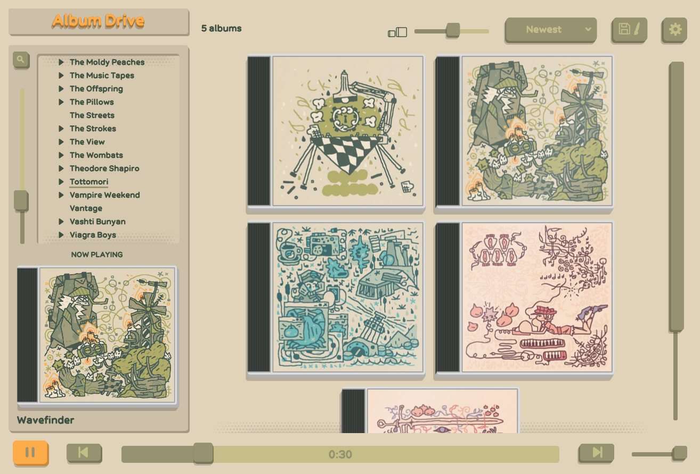
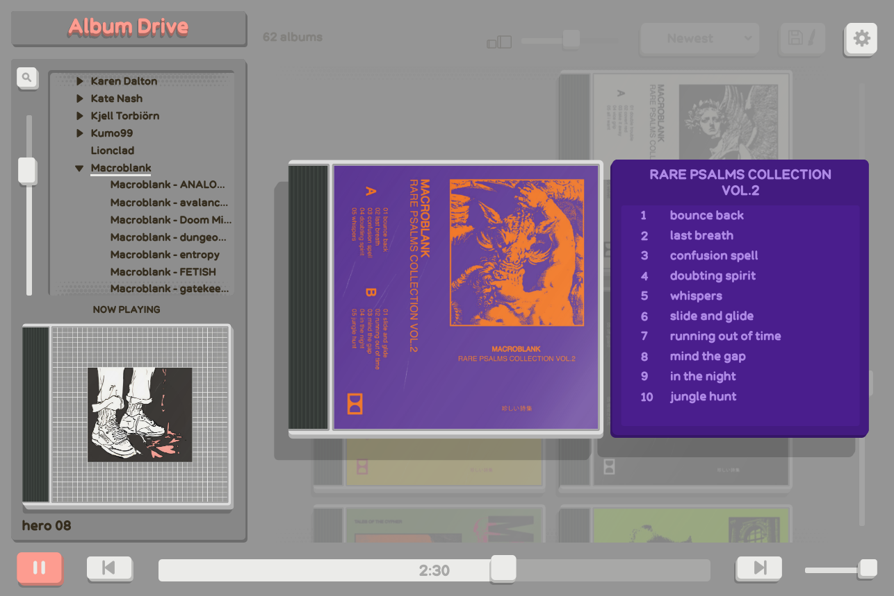

	

	<a href="https://github.com/KabisCube/Album-Drive/releases/latest">Download</a>

	
	

Album Drive is a simple and cute local music player that uses your folder structure instead of metadata to organize your music. It supports music folders and audio CDs in a CD/DVD drive.

Album Drive changes its theme to match each album's art. It can match the art as closely as possible, or pick colors that suit a dark or light theme. If you find a theme you like, you can save it and use that instead.

## Building from source

For building instuctions see [BUILDING.md](BUILDING.md).

## Found a bug?

Unexpected Python errors are recorded in `logs/errors.log` beside the app. Native crash details are recorded in `logs/crash.log`. If that folder is not writable, logs use the operating system's local app-data folder instead. If you run into bugs, please file a bug report with relevant crash and error logs.

## licenses
| Font | Use | License or notice |
| --- | --- | --- |
| Album Round Bold | Main interface; original for Album Drive | [GPLv3 notice](docs/licenses/fonts/AlbumRound-LICENSE.txt) |
| Album Marker 01–03 | Handwritten sleeves; original for Album Drive | [GPL-3.0-or-later notice](docs/licenses/fonts/handwriting/AlbumMarker-LICENSE.txt) |
| [Resource Han Rounded SC Bold](https://github.com/CyanoHao/Resource-Han-Rounded) | Japanese, Korean, and Chinese fallback; Cyano Hao, with portions by Adobe | [SIL Open Font License 1.1](docs/licenses/fonts/cjk/ResourceHanRounded-LICENSE.txt) |

