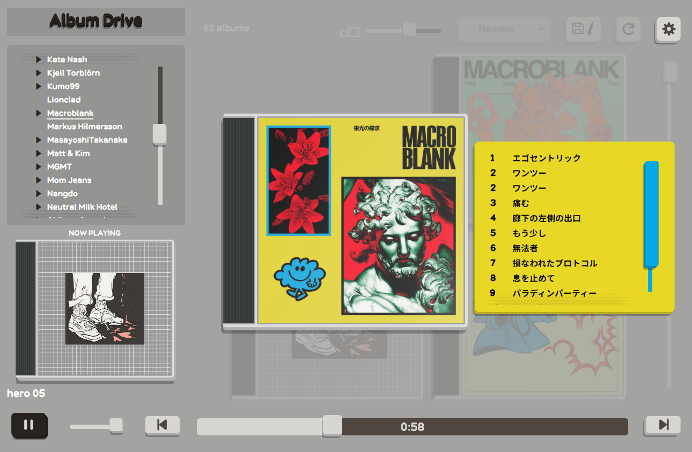

Album Drive is a simple local music player that uses your folder structure instead of metadata to organize your music. It supports music folders and audio CDs in a CD/DVD drive.

Albums are displayed in CD cases, using the cover image stored in each album's folder. By default, Album Drive changes its theme to match the album art. If you find one you like, it can then be saved and used globally.


## Download

[Download Album Drive from GitHub Releases](https://github.com/KabisCube/Album-Drive/releases).

Release packages include a `licenses/` folder with dependency and font notices.

## Requirements

Packaged builds include Python and the app dependencies; no Python installation is needed.

- **Windows:** 64-bit Windows.
- **Linux:** a compatible glibc-based graphical desktop and system audio/XCB libraries. CI uses Ubuntu 22.04.
- **Audio CDs:** currently Windows-only, with a drive that supports digital audio reading.

Playback support depends on the bundled Qt/FFmpeg backend and the individual file.

### Run from source

Source runs need Python 3.10+ and the packages in [requirements.txt](requirements.txt):

```sh
python -m pip install -r requirements.txt
python src/main.py
```

After creating `.venv` and installing the dependencies, you can also use `start-windows.bat` or `./start-linux.sh`.

### Build executables

Native executable builds must run on the target operating system:

```sh
python -m pip install -r requirements-build.txt
python scripts/build.py
```

On Linux, this command adds a launcher for the app's current location. Rerun it if you move the app:

```sh
./AlbumDrive --install-desktop-entry
```

### Logs

Unexpected Python errors are recorded in `logs/errors.log` beside the app. Native crash details are recorded in `logs/crash.log`. If that folder is not writable, logs use the operating system's local app-data folder instead.

## Project layout

| Folder | Contents |
| --- | --- |
| `src/` | Application code |
| `assets/` | Fonts, icons, and sounds |
| `scripts/` | Build tools, asset generators, and the test runner |
| `packaging/` | PyInstaller build specification |
| `tests/` | Unit tests |
| `tests/checks/` | UI and integration checks |
| `licenses/` | Bundled third-party license texts and notices |
| `build/` | Generated files and previews |
| `dist/` | Packaged releases |
| `logs/` | Runtime logs |

## Tests

Run unit tests:

```sh
python scripts/test.py
```

Run specific UI checks:

```sh
python scripts/test.py check_settings check_sorting
```

Run all UI checks:

```sh
python scripts/test.py --checks
```

## Font credits

Thanks to the designers who made these fonts available. These third-party fonts use the SIL Open Font License 1.1 and retain their own notices.

| Font | Creator | License or notice |
| --- | --- | --- |
| [Barato](https://www.behance.net/eddy_dsgn) | Edson Silva (eddy.dsgn) | [OFL license](licenses/fonts/handwriting/barato/OFL.txt); [notice](licenses/fonts/handwriting/barato/readme.txt) |
| [Elatox](https://ggbot.itch.io/elatox-font), regular and italic | GGBotNet | [License](licenses/fonts/handwriting/elatox/License.txt) |
| [Mistral SingleLine Outline](https://github.com/isdat-type/Mistral-SingleLine) | Francois Chastanet, Elisa Garzelli, Anais Alves and Morgane Autin; isdaT-type | [License](licenses/fonts/handwriting/mistral_singleline/OFL.txt) |
| [TMT Caffeine](https://toomuchtype.com/), Regular and Scrabble | Gabriel Drozdov / Too Much Type | [License](licenses/fonts/handwriting/TMT_caffeine/license.txt) |
| [Resource Han Rounded SC Bold](https://github.com/CyanoHao/Resource-Han-Rounded) | Cyano Hao, with portions by Adobe | [License](licenses/fonts/cjk/ResourceHanRounded-LICENSE.txt) |

Mistral SingleLine is based on Roger Excoffon's Mistral.

Album Round is the project's original font, distributed under [GPLv3](LICENSE). Its notice is in [AlbumRound-LICENSE.txt](licenses/fonts/AlbumRound-LICENSE.txt).

Album Round uses bundled Resource Han Rounded Bold glyphs for Japanese, Korean, and Chinese text. The fonts work offline and retain their separate licenses in `licenses/fonts/`. Other scripts use fonts available on the operating system.
