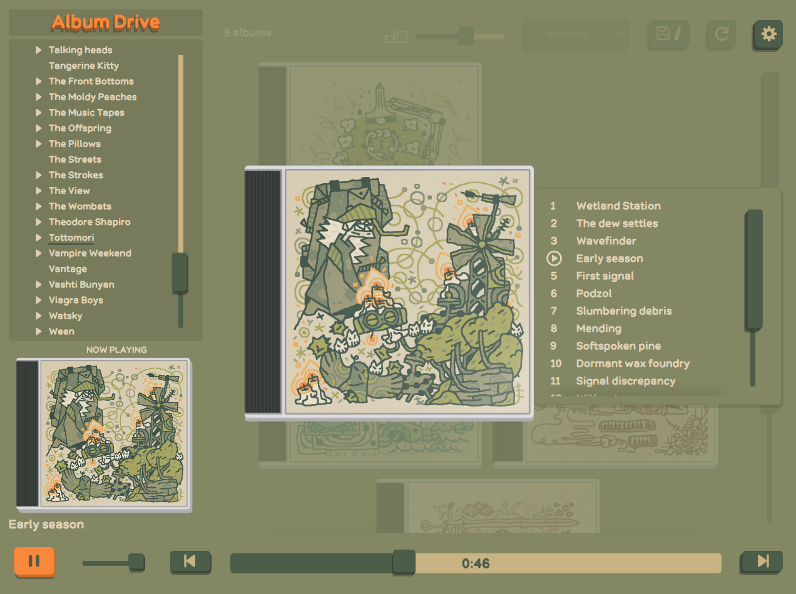

Album Drive is a simple local music player that uses your folder structure instead of metadata to organize your music. It supports music folders and audio CDs in a CD/DVD drive.

Selecting a folder generates CD cases for each album. If no image is stored with the album, Album Drive will display a blank paper with the album name written on it instead. By default, Album Drive changes its theme to match the album art with additional settings for if you prefer to only get dark or light themes. If you find one you like, it can then be saved and used globally.

## Download

[Download Album Drive from GitHub Releases](https://github.com/KabisCube/Album-Drive/releases).

## Requirements

Packaged builds include Python and the app dependencies; no Python installation is needed.

- **Windows:** 64-bit Windows.
- **Linux:** 64-bit x86 Linux with a glibc-based graphical desktop and the required graphics, audio, and XCB libraries. CI targets Ubuntu 22.04.
- **Audio CDs:** currently Windows-only, with a drive that supports digital audio reading.

Playback support depends on the bundled Qt/FFmpeg backend and the individual file.

### Logs

Unexpected Python errors are recorded in `logs/errors.log` beside the app. Native crash details are recorded in `logs/crash.log`. If that folder is not writable, logs use the operating system's local app-data folder instead. If you run into bugs, please file a bug report with relevant crash and error logs.

## licenses
| Font | Use | License or notice |
| --- | --- | --- |
| Album Round Bold | Main interface; original for Album Drive | [GPLv3 notice](licenses/fonts/AlbumRound-LICENSE.txt) |
| Album Marker 01–03 | Handwritten sleeves; original for Album Drive | [GPL-3.0-or-later notice](licenses/fonts/handwriting/AlbumMarker-LICENSE.txt) |
| [Resource Han Rounded SC Bold](https://github.com/CyanoHao/Resource-Han-Rounded) | Japanese, Korean, and Chinese fallback; Cyano Hao, with portions by Adobe | [SIL Open Font License 1.1](licenses/fonts/cjk/ResourceHanRounded-LICENSE.txt) |

